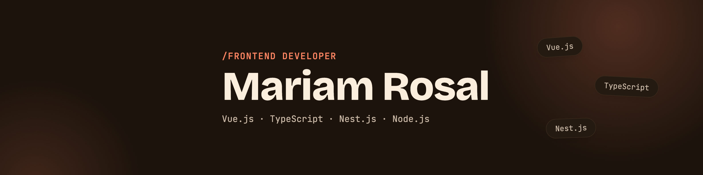

<picture>
  <source media="(prefers-color-scheme: dark)" srcset="assets/banner-oscuro.png">
  <source media="(prefers-color-scheme: light)" srcset="assets/banner-claro.png">
  
</picture>

 

## 👩‍💻 Sobre mí

<table>
  <tr>
    <td width="62%" valign="middle">
      
¡Hola! Soy <b>Mariam</b>, desarrolladora Frontend e Ingeniera de Sistemas con más de 6 años de experiencia creando aplicaciones web, plataformas administrativas, sitios corporativos y soluciones de comercio digital.

      <ul>
        <li>💻 Me especializo en desarrollo frontend moderno con <b>TypeScript</b> y <b>JavaScript</b>, y me adapto a las herramientas que cada proyecto necesita.</li>
        <li>🎨 Diseño interfaces funcionales, accesibles y adaptables a cualquier dispositivo.</li>
        <li>🧩 Combino enfoque técnico y de producto para convertir procesos complejos en experiencias claras.</li>
        <li>🌱 Siempre aprendiendo y buscando mejores formas de construir productos.</li>
      </ul>
    </td>
    <td width="38%" align="center" valign="middle">
      
    </td>
  </tr>
</table>

## 🛠️ Stack

  

## 🗂️ Mi trabajo

Los proyectos en los que he trabajado están en mi portafolio, con su descripción, tecnologías y capturas.

👉 **[Ver mi portafolio](https://majoh99.github.io/portfolio/)**

## 📈 Actividad en GitHub

  
  

## 🤝 Hablemos

¿Tienes un proyecto en mente o quieres colaborar? Escríbeme por [LinkedIn](https://linkedin.com/in/mariam-rosal/) o a [mariamrosalm@gmail.com](mailto:mariamrosalm@gmail.com).

*Nos vemos en el próximo commit* 🌸

